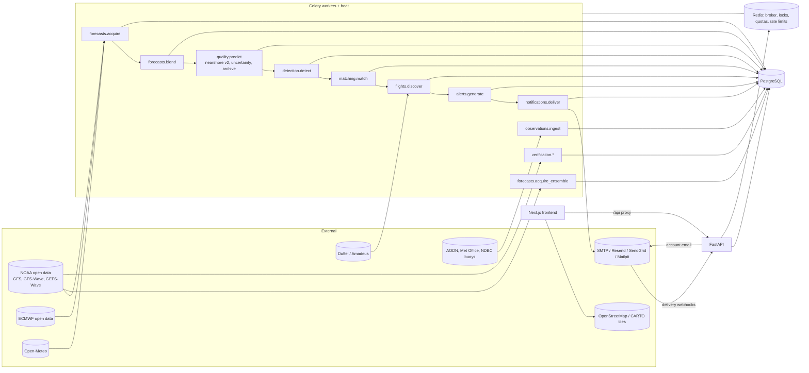

# Debug audit

Audit of the Swell Travel Agent repository, carried out before and during the forecasting
upgrade (October 2026). For every defect: what was observed, the evidence, the root cause,
the files changed, the fix, the tests that now cover it and the verified outcome. Defects are
grouped by subsystem. "Verified live" means reproduced and re-checked against the running
application or the real external service; "verified with mocks" means only automated tests
with stubbed providers.

## 1. Stack inventory

| Layer | Component | Version |
|---|---|---|
| API | FastAPI / Uvicorn | 0.143.0 / 0.54.0 |
| ORM, migrations | SQLAlchemy / Alembic | 2.1.4 / 1.20.0 |
| Settings | Pydantic / pydantic-settings | 2.14.0 |
| Jobs | Celery (Redis broker, beat scheduler) | 5.6.3 |
| Database | PostgreSQL | 16 (`postgres:16-alpine`) |
| Cache, locks, quotas | Redis | 7 (`redis:7-alpine`), redis-py 8.1.0 |
| HTTP clients | httpx | 0.28.1 |
| Numerics | numpy / pandas | 2.5.3 / 3.0.6 |
| GRIB2 decoding | ecCodes (`eccodes` + `eccodeslib` wheel) | 2.49.0 |
| Parquet (AODN buoys) | pyarrow | 26.0.0 |
| ML baselines | scikit-learn / joblib | 1.9.1 / 1.6.0 |
| Frontend | Next.js / React / TypeScript | 16.4.0 / 19.3.0 / 5.9.3 |
| Data fetching | TanStack Query | 5.104.1 |
| Map | Leaflet / react-leaflet | 1.9.4 / 5.0.0 |
| Charts | Recharts | 3.10.1 |
| Styling | Tailwind CSS | 4.3.3 |
| Tests | pytest 9 / Vitest 3.2.7 / Playwright 1.64.0 | |
| Dev inbox | Mailpit | v1.27 |
| Images | `python:3.12-slim`, `node:22-alpine` | |

## 2. Dependency diagram



Each Celery stage is idempotent, takes a Redis lock and logs to `background_job_logs`. The API
never calls forecast or flight providers on a user request: all users read the same cached,
centrally acquired data.

## 3. Interactive map

### 3.1 Tiles render as "API KEY REQUIRED"

- **Symptom.** User screenshot: every tile showed the text "API KEY REQUIRED"; the markers
  drew on a grey background.
- **Evidence.** The default tile URL was CARTO's `basemaps.cartocdn.com` raster endpoint.
  Requesting a tile without a key returned HTTP 200 with a PNG containing that text, so
  Leaflet reported success and no error was ever logged.
- **Root cause.** CARTO started requiring an API key for raster basemaps; the app defaulted
  to a keyless CARTO URL.
- **Files.** `frontend/lib/map-tiles.ts`, `frontend/next.config.ts`,
  `frontend/components/map/surf-map.tsx`, `docker-compose.yml`, `.env.example`.
- **Fix.** OpenStreetMap is the default (with its required attribution and a
  `strict-origin-when-cross-origin` Referer, per the OSM tile policy). CARTO is used only
  when `NEXT_PUBLIC_CARTO_API_KEY` is set; a CARTO URL without a key logs a build warning.
  The Content-Security-Policy `img-src` is derived from the configured tile host, so
  changing the provider cannot silently be blocked by CSP.
- **Tests.** `frontend/tests/map-tiles.test.ts` (URL, CSP and key handling);
  `frontend/e2e/map.spec.ts` "loads with 50 markers, working tiles…" (tiles stubbed by
  default; `E2E_REAL_TILES=1` loads real OSM tiles and checks they decode).
- **Outcome.** Verified live by the user and with `E2E_REAL_TILES=1`.

### 3.2 Related map defects found while fixing 3.1

| Defect | Root cause | Fix |
|---|---|---|
| Map sometimes rendered grey until a window resize | Leaflet measures its container once; the container size changes after layout | `InvalidateOnResize` (ResizeObserver → `invalidateSize`) |
| Map overlapped the sticky header when scrolling | Leaflet panes use z-index 400+ in the page's stacking context | wrapper `isolation: isolate` |
| Markers could not be targeted by tests or styles | `className` inside `pathOptions` is ignored by Leaflet after creation | pass `className` as a direct prop |
| Silent failure when every tile fails | no tile error handling | notice after 4 tile errors with 0 loads |
| Forecast-time slider label did not match the data | slider index 0 was the browser's "now", the data the server's nearest hour | index 0 uses the server snapshot's `valid_time`; range start floored to the hour |

The map upgrade (forecast-time control, filters, legend, raw-vs-predicted panel, charts) is
covered by `frontend/e2e/map.spec.ts` (6 tests) and `frontend/e2e/spot.spec.ts` (2 tests).

## 4. Email verification

### 4.1 Verification emails "sent" but never received

- **Symptom.** After registering, the UI said a verification email was sent; nothing
  arrived.
- **Evidence.** With the default `EMAIL_PROVIDER=console` the message was appended to a file
  inside the worker container (`/tmp/swell-outbox/outbox.jsonl`), which nobody could see.
  There was no record of the attempt in the database, so neither the UI nor support could
  tell what had happened.
- **Root cause.** The development default captured mail invisibly while the UI reported
  delivery; account emails had no delivery tracking at all.
- **Files.** `backend/app/models/messaging.py` (`email_messages`),
  `alembic/versions/0002_email_delivery_tracking.py`,
  `backend/app/services/notifications/{transactional,providers,delivery_events}.py`,
  `backend/app/workers/{dispatch,tasks}.py`, `backend/app/api/{auth,webhooks,dev}.py`,
  `backend/app/core/config.py`, `docker-compose.yml`, `frontend/app/dashboard/page.tsx`,
  `frontend/app/verify-email/verify.tsx`, `frontend/lib/delivery.ts`.
- **Fix.**
  - Mailpit runs in Docker Compose and is the default provider there: every email is
    viewable at `http://localhost:8025`.
  - Every account email has an `email_messages` row whose status only claims what is known:
    `queued → sending → accepted` (the provider took it) or `captured` (dev inbox), then
    `delivered` / `bounced` / `complained` only from a signed provider webhook (Resend:
    Svix HMAC; SendGrid: ECDSA P-256), advancing forward-only.
  - The dashboard banner polls `/api/auth/verification-status` and links to the dev inbox
    when mail is captured locally.
  - Transient failures retry with exponential backoff (6 attempts) and end as `failed`.
  - Production refuses capture-only providers at start-up.
  - Verification tokens are never written to logs; bodies (which contain tokens) are not
    stored.
- **Tests.** `backend/tests/integration/test_email_delivery.py`,
  `backend/tests/unit/test_delivery_events.py`, `test_auth_api.py`,
  `frontend/e2e/full-flow.spec.ts`.
- **Outcome.** Verified live in Docker: the email reached Mailpit (checked through
  Mailpit's API) and the link verified the account. Resend/SendGrid delivery confirmation is
  verified with signed test payloads only; real provider delivery needs real credentials
  and DNS (SPF/DKIM) and was not tested.

### 4.2 Confusing results when the link is reused or replaced

- **Symptom.** Clicking a verification link a second time showed "invalid token".
- **Root cause.** A used token was treated like a forged one.
- **Fix.** `verify_email` returns `verified` or `already_verified`; a token superseded by a
  newer email says so. A public, non-enumerating "resend" endpoint (rate limited per IP and
  per address) lets a signed-out user request a new link.
- **Tests.** `test_auth_api.py` (replay, superseded link, public resend).

### 4.3 Latent defects found in the same area

| Defect | Root cause | Fix |
|---|---|---|
| Email links pointed at the wrong port in Docker | `APP_BASE_URL` default ignored `FRONTEND_PORT` | compose derives `APP_BASE_URL`, `API_BASE_URL`, `CORS_ORIGINS` from the port variables |
| Template always said "valid for 48 hours" | hardcoded text | the TTL setting is passed to the template |
| A transient SMTP error raised inside the API request in eager mode | Celery's `retry()` re-raises when `task_always_eager` | eager mode retries in-process; workers use `self.retry(countdown=…)` |

## 5. Swell alert emails

### 5.1 Alerts silently dropped or mislabelled

- **Symptoms.** Some users never got alerts; others saw "sent" for messages that only went to
  a local file.
- **Evidence.** In the pipeline, alerts for unverified email addresses were skipped without
  a record; alerts above the daily cap vanished; console deliveries were labelled `sent`.
- **Root cause.** Suppression had no persistence and the status vocabulary could not express
  "captured" or "accepted but not confirmed".
- **Files.** `backend/app/services/notifications/{alerts,delivery,templates}.py`,
  `backend/app/models/{enums,opportunity}.py`, migration 0002,
  `frontend/app/notifications/page.tsx`.
- **Fix.** Suppressed alerts are stored with their reason ("email address not verified",
  daily cap) and do not mark the opportunity as alerted, so they are sent once the reason
  clears. Statuses follow the same honest lifecycle as account email. Alert emails now carry
  the swell dates, our predicted breaking height labelled as an estimate, the raw offshore
  forecast, when the forecast was updated, suggested travel dates and buffers, flight offers
  (with a MOCK FARE note in demo mode), and links to the dashboard and to manage alerts.
- **Tests.** `backend/tests/integration/test_pipeline.py`
  (`test_suppressed_alert_is_sent_after_verification` and suppression assertions),
  `test_email_delivery.py`, `test_notification_providers.py`.
- **Outcome.** Verified live in Docker: an alert reached Mailpit with all required fields,
  and the unverified user's alert showed "Not sent: email address not verified".

## 6. Forecast engine (found during the upgrade)

| # | Defect | Evidence | Root cause | Fix | Covered by |
|---|---|---|---|---|---|
| 6.1 | Spot forecast API always claimed `komar_gaughan_v1_uncalibrated` | the response kept that label after the model changed | method name hardcoded in `spot_views.spot_forecast` | report the method stored on the predictions | `test_public_and_opportunity_api.py`, `e2e/spot.spec.ts` |
| 6.2 | Spot page said "Komar–Gaughan approximation" whatever the method | hardcoded text | same pattern in `app/spots/[slug]/page.tsx` | uses `methodLabel()` of the reported method | `e2e/spot.spec.ts` |
| 6.3 | After an algorithm upgrade, the live forecast kept old-version scores until the next model run | forced re-acquisition reused the run; stored predictions are only inserted once | no rescoring path | `outdated_authoritative_runs` rescored when the version differs; the prediction archive keeps what was issued | `test_blend.py` |
| 6.4 | Two runs of one source issued in the same hour overwrote each other in the archive | demo simulations archived 0 rows | archive unique key used the issue time, not the run | key `(source_code, run_key, spot_id, valid_time)` | `test_blend.py` |
| 6.5 | Scoring a run took 37 s after the v2 model landed; the e2e `simulate-swell` call timed out at the proxy | profiler: 3.4 M Python calls in the directional integral | per-hour Python loop over directions | tabulated angular response per profile, cached kernels, memoised factor: 37 s → 9 s per run | e2e `map.spec.ts` (simulate-swell) |
| 6.6 | Uncertainty lead table slightly optimistic | research re-analysis | table derived with flat seas excluded | unfiltered table, spread scale 1.05 | `test_nearshore.py` |

Further limitations the research found and that are documented rather than changed: Open-Meteo
wind is requested at the break coordinates, where 33 of 50 GFS stencils include land (the
largest wind-speed effect found was 0.82 m/s; the direct NOAA ingester uses a sea-only cell);
`gfs_seamless` blends HRRR over the United States; Open-Meteo's sea level comes from a
different (CMEMS) model; Puerto Escondido's forecast point is a missing (land) cell in NOAA's
`global.0p25` grid, which the GRIB ingester handles by taking the nearest valid sea cell.

### 6.1 Defects found on the first live NOAA + ECMWF run (2026-10-11)

The demo provider always produces a dominant swell and a single model, so these only
appeared on real data.

| Defect | Root cause | Fix |
|---|---|---|
| Alerts and event cards reported "0.16 m @ 11 s swell" at Burleigh Heads while predicting 6–8 ft faces | the event headline was always WW3's primary swell partition, but WW3 ranks only the swells; a 2.0 m wind sea carried the energy | the headline is now the partition with the largest predicted breaking height (`surf_quality.breaking.dominant_component`), also used by the map and spot conditions; labelled "main offshore waves" |
| ECMWF's CC BY 4.0 attribution was not shown when the blend was authoritative | the spot page showed only the blend source's own generic text | a blend shows every member's attribution (`spot_views.source_attribution`) |
| The map's "best at the selected time" list ranked spots in darkness as "Exceptional" | it sorted by score at the selected hour, day or night | daylight spots rank first; night entries are tagged, and conditions say "night (not surfable)" |
| "1.5–1.5 ft" and "run — UTC" on the spot page | a collapsed range and a blend without a single model run time | one value is shown; a missing run time is omitted |
| Alert emails gave the point estimate only | the uncertainty range never reached the alert snapshot | the 80% range at the event peak and how it was made are in every alert |

Checked and **not** defects: 1,334 of 4,050 blend hours flagged as model disagreement
(real GFS/ECMWF differences, concentrated at sheltered spots such as Rincon, where ECMWF
had a 2.1–2.4 m wind sea and GFS 0.5–0.9 m); the range labelled `heuristic` rather than
`ensemble_heuristic` in half the blend hours (the between-model spread exceeded the GEFS
spread there, and the larger one is used). Documented limitation: on this run many
world-class spots scored 90–100 at their best hour, so the top of the uncalibrated
quality scale is not rare enough.

## 7. Test and tooling defects

| Defect | Root cause | Fix |
|---|---|---|
| e2e full-flow test failed at some times of day | two simulated swells' 8-hour Gaussian tails bridged the gap meant to separate them | second swell moved to 10.8 days with a 30-hour plateau |
| A failing Vitest run was committed | the exit code was read through a pipe | exit codes are checked directly |
| `next build` with a custom `distDir` rewrites `tsconfig.json` | Next.js adds the dist dir to `include` | the e2e runner's change is reverted before committing |
| An inline comment in `.gitignore` broke the rule | `.gitignore` has no inline comments | comment moved to its own line |
| The 15-step e2e scenario failed only in a full-suite run | other specs leave simulated Jeffreys Bay swells in the shared e2e database, so the scenario's new search matched one as soon as it was activated (eager Celery ran the whole alert chain inside the request) | the scenario uses a spot no other spec simulates swells at |
| Playwright could not find its browser | the pinned Playwright expects a newer headless shell than the one installed | `PLAYWRIGHT_CHROMIUM_PATH=/opt/pw-browsers/chromium` (supported by `playwright.config.ts`) |

## 8. How to re-run the checks

```bash
# backend: unit + integration (PostgreSQL and Redis running)
cd backend && .venv/bin/python -m pytest -q
cd backend && .venv/bin/ruff check app tests && .venv/bin/mypy app
# migrations: upgrade, drift check, downgrade, upgrade
cd backend && alembic upgrade head && alembic check && alembic downgrade 0002_email_delivery && alembic upgrade head
# frontend
cd frontend && npx tsc --noEmit && npx eslint . && npx vitest run
# end to end (fresh database, demo providers, production build; Mailpit inbox in Docker)
E2E_MAILPIT=1 PLAYWRIGHT_CHROMIUM_PATH=/opt/pw-browsers/chromium ./scripts/run-e2e.sh
# live ingestion (separate scratch database; ~3 GB of NOAA/ECMWF downloads)
DATABASE_URL=…/swell_live GEFS_ENABLED=true python -m app.cli engine ensemble
DATABASE_URL=…/swell_live FORECAST_PROVIDERS=noaa_gfs,ecmwf_ifs python -m app.cli pipeline
```
